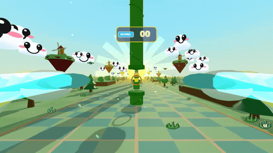

# 🪶 Floppy Flight VR

A 3D first-person Virtual Reality game for the **Meta Quest 3**, inspired by classic Flappy Bird.



Fly from the first-person perspective of a bird through retro 3D pipe obstacles! Gain altitude by physically flapping your Quest Touch Plus controllers downward, or pull the controller triggers.

---

## 🌟 Features

- **True 6DoF Controller Flapping:** Swing your controllers downward to generate aerodynamic lift. Flapping both hands gives a powerful boost, while single-hand flaps provide subtle banking.
- **First-Person Avian View:** A stylized 3D bird beak bobbing in your lower peripheral field of view, and feathered cartoon wings attached directly to your VR controllers that flutter as you flap!
- **Haptic Feedback:** Tactile impulses triggered on your Meta Touch Plus controllers on every flap, score chime, and collision.
- **Iconic 3D Obstacles:** Classic green pipes with collars, spinning golden rings, and progressive speed scaling as your score climbs.
- **Procedural Sound FX:** 100% synthesized real-time audio via Web Audio API (wing whooshes, chimes, and bonks) with zero external asset dependencies.
- **Zero Install Friction:** Powered by Three.js and WebXR. Runs directly inside the **Meta Quest Browser** at 90Hz/120Hz.

---

## 🎮 Controls

| Action | Meta Quest 3 | Desktop (Preview) |
| :--- | :--- | :--- |
| **Flap Wings / Lift** | Flap controllers downward | `Space`, `W`, or Mouse Click |
| **Accessibility Flap** | Pull Trigger or Grip button | Mouse Click |
| **Look Around** | Full 6DoF Headset Tracking | Mouse Look |
| **Start / Retry** | Flap controllers down | `Space` or Click |

---

## 🚀 How to Run Locally for Meta Quest 3

Because WebXR requires HTTPS, this project includes a self-signed SSL dev server.

1. **Start the local HTTPS server:**
   ```bash
   npm run dev
   ```
2. Note your local network IP (e.g., `https://192.168.1.X:5173`).
3. Put on your **Meta Quest 3**, open the **Meta Quest Browser**, and navigate to that URL.
4. Click **ENTER VR** and start flapping!

---

## 🌐 Deploying to GitHub Pages

To make it accessible worldwide without local Wi-Fi:
1. Push this repository to GitHub.
2. Enable GitHub Pages in the repository settings (or use GitHub Actions).
3. Open `https://<your-username>.github.io/floppy-flight/` in the Quest Browser!

---

## 📦 Unity project for the Horizon Store

The installable Quest app lives in [`unity/`](unity/). It targets **Unity 6.0 LTS `6000.0.83f1`** (the newest 6000.0 patch that already has a GameCI Android editor image; Meta XR SDK 207 requires `6000.0.66f2` or newer). `ProjectSettings/` and `Packages/` were not in the repository, so this project was created around the existing C# scripts.

Open `unity/` in that editor with Android Build Support (SDK, NDK, OpenJDK). Package Manager installs **Meta XR All-in-One SDK** `com.meta.xr.sdk.all` **207.0.1** from `Packages/manifest.json`, plus OpenXR. The heavy Meta packages are resolved from `https://npm.developer.oculus.com`. The small All-in-One wrapper is resolved from Unity's registry. If Unity reports that the account has not acquired the All-in-One package, add [Meta XR All-in-One SDK](https://assetstore.unity.com/packages/tools/integration/meta-xr-all-in-one-sdk-269657) to the same Unity account used for the license, then reopen the project.

`Assets/Editor/BuildScript.cs` runs on editor load and again before every release build. It sets the Horizon Store player configuration and enables OpenXR:

| Setting | Value |
| :--- | :--- |
| Company / product | Capitech AB / Floppy Flight |
| Package name | `com.capitechab.floppyflight` |
| Version | `1.0.0`. versionCode comes from `ANDROID_VERSION_CODE`, or the GitHub run number in CI. `0` is raised to `1`. Horizon accepts any positive code on the first upload; later uploads must be higher. |
| Scripting backend | IL2CPP, ARM64 only |
| Min / target API | 32 / 34 (Android 14). New Horizon apps created after 1 March 2026 must target API 34. |
| Graphics | Vulkan only, linear color space, multithreaded rendering |
| Input | Input System Package only (`activeInputHandler: 1` in `ProjectSettings/ProjectSettings.asset`). Both is unsupported on Android and breaks Meta XR serialization. `com.unity.inputsystem` 1.20.1 is in the manifest. |
| XR | OpenXR loader, Meta Quest Support, and the Meta XR feature group. Meta's build step then keeps the loader inside OVRPlugin and drops Unity's `openxr_loader.aar`, because both ship `libopenxr_loader.so` and the binaries are not the same. A launcher `jniLibs.pickFirsts` entry covers any leftover copy. Oculus Touch / Touch Pro / Touch Plus profiles, Single Pass Instanced (Vulkan multiview). Symmetric projection is off so Quest 1 in the default device list cannot fail validation. System keyboard is off in both Meta Quest Support and OVR Project Config so the manifest does not declare `oculus.software.overlay_keyboard` twice. Latency optimization is Prioritize Input Polling. |
| Devices | Quest 2, Quest Pro, Quest 3, Quest 3S |
| Activity | Game Activity (`AndroidApplicationEntry.GameActivity` only) |
| Permissions | Internet, for entitlements and leaderboards |

The release scene is generated into `Assets/Scenes/Main.unity` the first time the editor or the build script runs, because the scripts shipped without a scene. That scene wires the background track plus the flap, bonk, game-over, "Fight", "Uh ooh", and score-announcer clips under `Assets/Audio`. OpenXR assets under `Assets/XR/` and `Packages/packages-lock.json` are also written on that first import. Commit those after a successful editor open so later builds stay reproducible. The build writes the Meta Platform mobile app id and expects a leaderboard whose API name is `floppy_highscores`.

### Local signed `.apk`

The Horizon Developer Dashboard upload is a signed release APK (arm64, no OBB, target API 34, APK Signature Scheme v2). Do not commit a keystore or a password. From a shell that has an activated Unity 6000.0.83f1 editor:

```bash
export ANDROID_KEYSTORE_PATH=/path/to/upload.keystore
export ANDROID_KEYSTORE_PASS='...'
export ANDROID_KEYALIAS_NAME='upload'
export ANDROID_KEYALIAS_PASS='...'
export META_APP_ID='0000000000000000'

Unity -batchmode -nographics -quit \
  -projectPath unity \
  -executeMethod FloppyFlight.Editor.BuildScript.BuildAndroidApk \
  -logFile -
```

`ANDROID_KEYSTORE_BASE64` can be used instead of a path. The APK is written to `build/Android/FloppyFlight.apk` unless `-customBuildPath` or `APK_OUTPUT` is set. `BuildAndroidAab` still writes an App Bundle. Passwords are cleared from Player Settings after the build. The script does not turn off v2 signing.

### GitHub Actions

[`.github/workflows/quest-release-aab.yml`](.github/workflows/quest-release-aab.yml) uses `game-ci/unity-builder@v4` to build the signed APK and upload it as the `FloppyFlight-Quest-release-apk` artifact. Run it from the Actions tab, or by pushing a change under `unity/`. The workflow dispatch input `package` can be set to `aab` to build an App Bundle instead.

Create these **repository secrets** before the first run ([GameCI license activation](https://game.ci/docs/github/activation)):

| Secret | What to put in it |
| :--- | :--- |
| `UNITY_LICENSE` | Unity Personal license file (`.ulf`) contents |
| `UNITY_EMAIL` | Unity account email. The account must own the Meta XR All-in-One SDK entitlement if the wrapper package asks for one. |
| `UNITY_PASSWORD` | Unity account password. Use letters and digits only; GameCI has trouble with symbols. |
| `ANDROID_KEYSTORE_BASE64` | `base64 -w 0 upload.keystore` |
| `ANDROID_KEYSTORE_PASS` | Keystore password |
| `ANDROID_KEYALIAS_NAME` | Key alias |
| `ANDROID_KEYALIAS_PASS` | Key alias password |
| `META_APP_ID` | Quest app id from the [Meta Horizon Developer Dashboard](https://developers.meta.com/horizon/manage/). The entitlement check quits the app when this is missing or the user does not own the app. |

Also create a leaderboard in that dashboard whose API name is exactly `floppy_highscores`.

This environment does not have Unity installed and does not have those secrets, so a signed APK cannot be produced here. The workflow is what produces it once the secrets exist.

### Store listing assets

Draft art generated from the game's sunset, pipe, beak, and wing palette is in [`StoreAssets/`](StoreAssets/):

- `icon-512.png` — 512×512, 24-bit PNG, square corners, no transparency
- `banner-2560x1440.png` — cover landscape, 2560×1440, 24-bit PNG, title spelled **Floppy Flight**

These are drafts for the dashboard, not a finished marketing pass.

Still required before submission, and **not** in the repo:

- **5 unique screenshots**, each 2560×1440, 16:9, 24-bit PNG, captured from the Quest build's point of view. No marketing banners, badges, or other-platform headsets. Suggested set: approaching a vine-covered pipe gap with the golden beak in view; flying through a spinning golden ring; a near miss; a wider sunset vista with islands and a windmill; a later pipe after the score has climbed. `gameplay.mp4` / `gameplay.gif` are 1280×720 browser captures with title-screen text, so they cannot be submitted as this screenshot set.
- Cover square 1440×1440, cover portrait 1008×1440, and hero cover 3000×900 if the dashboard asks for them.
- **Pricing** is chosen in the Horizon Developer Dashboard (free or a paid tier). Nothing in the project sets a price. The build has no in-app purchases.
- A short MP4 trailer is optional. Minimum 1080p, maximum 2K.
